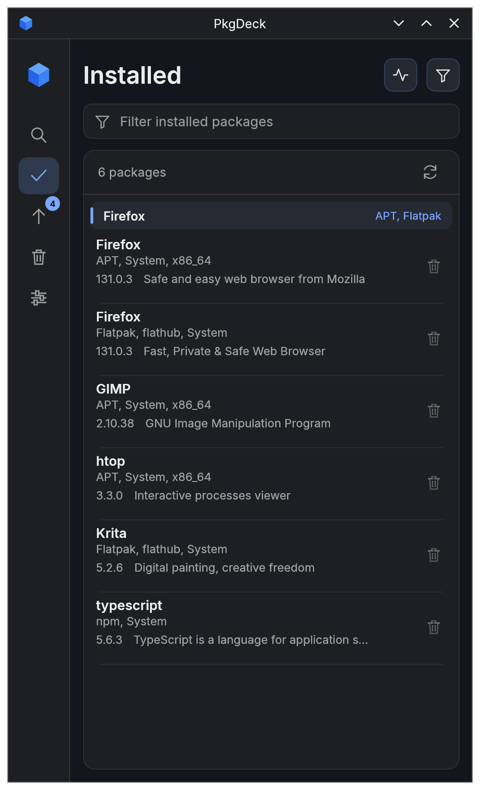
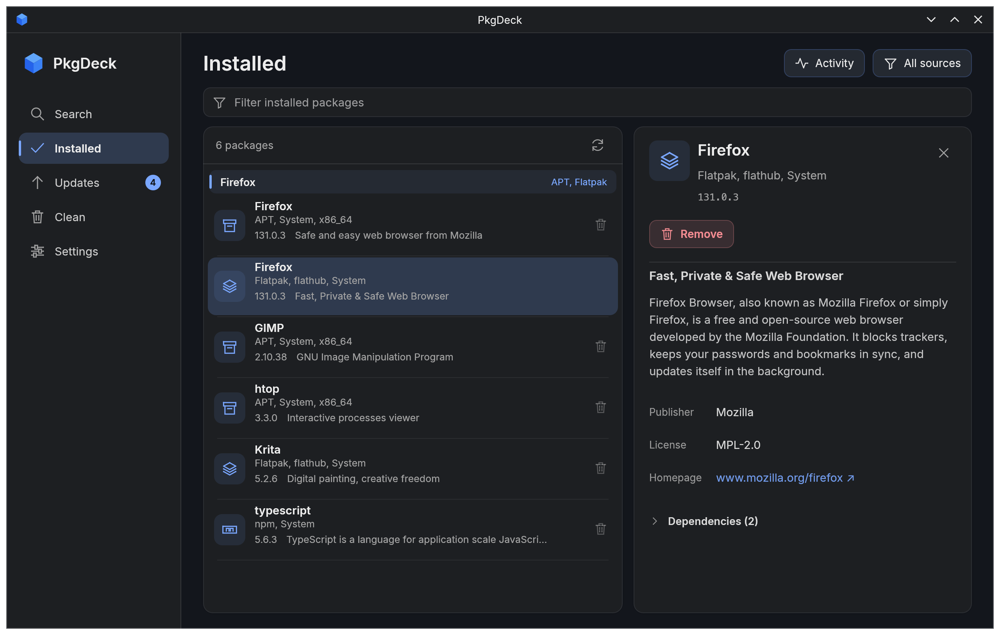
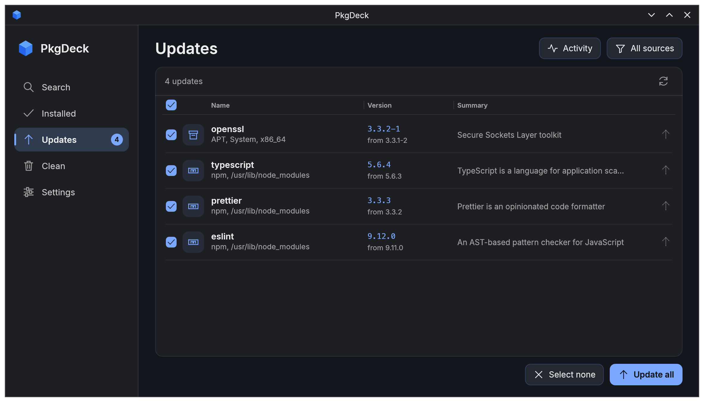
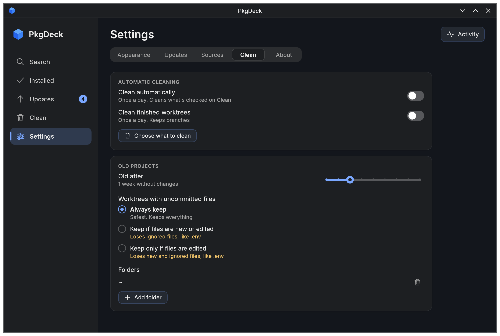
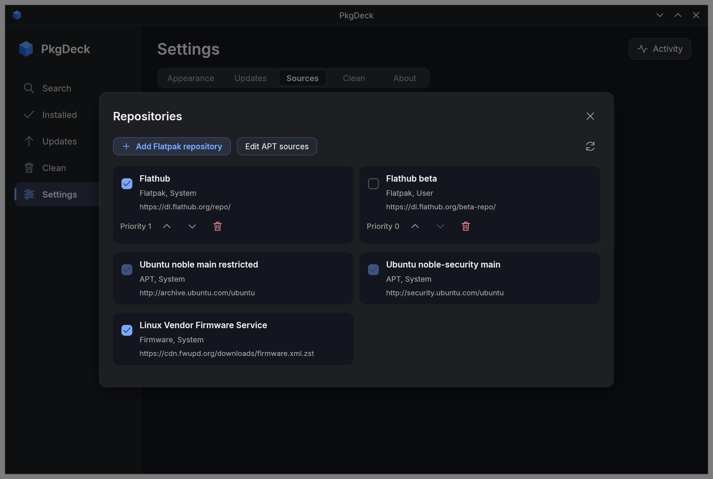

# Using the app

Open PkgDeck from your app menu or run `pkgdeck`. The sidebar has five pages:
**Search**, **Installed**, **Updates**, **Clean**, and **Settings**.
The **Updates** badge counts the updates found.

The **Activity** button in the header opens a drawer from the right, with
running and finished work. Its badge counts changes waiting their turn.

When a change fails, a short message says so, with **Details**. The failure
then waits in **Activity**, marked by a dot, with **Retry** and **Dismiss**.

Drag the sidebar's edge to resize it. Drag it thin, or make the window
narrow, and it shows only icons. Double-click the edge to reset it. In
**macOS 27**, **Windows 11** and **GNOME 51**, whose title bar is one with
the window, the edge runs up through the title bar too.

## Search

Type an app or package name. Exact matches come first, and the same app from
different package managers is shown together. Each row keeps its own source,
architecture, and scope (User or System), so you always act on one exact
package. A Flatpak found in both places shows one row, with **System** first
and opened by default. If only one copy is installed, that copy is shown
instead. Switch to **User** in the details; PkgDeck remembers your last
choice for that app.

- The button on the right of a row installs, removes, or updates that package.
  Some sources only keep what's already installed up to date, such as
  firmware and the standalone tools. Their rows show **Remove** only when
  the source can uninstall, and only when no update is waiting.
- Click a row (or press Space on it) to open its app page: icon, version,
  screenshots, description, publisher, license, homepage, and dependencies,
  when the source provides them, with its **Install**, **Remove** or
  **Update** button. An installed package with an update waiting shows
  **Update** next to **Remove**. **Back** (or Esc, Alt+←, or the mouse's back button)
  returns to the list as it was. Arrow
  keys only move the selection.
- In wide windows the app page opens beside the list. Drag the line between
  them to change its width, or double-click it to reset. PkgDeck remembers
  the width.
- In narrow windows the app page slides over the list. **Back** returns to
  it.
- App names, icons, and screenshots come from the source. Packages without
  app metadata show their package name.
- A very short search can match tens of thousands of packages. The list
  shows the best 500 and says how many matched. Type more to narrow it.

## Open a package file or link

On Search, click **Install from file…**, drop a file onto the window, or pass a path or link
to `pkgdeck`. If PkgDeck is already open, the file goes to the open window.
It opens on its own app page, with what the file or link says about itself
and where it came from. Nothing installs until you press **Install** there.

| Kind | Formats |
| --- | --- |
| Packages | `.AppImage` (any capitalization), `.deb`, `.rpm`, `.pkg.tar.zst` (also `.xz`, `.gz`, `.bz2`, `.lz4`), `.flatpak`, `.flatpakref`, `.snap` with its `.assert` file |
| Repositories | `.flatpakrepo`, `.repo`, `.sources`, `.list`, openSUSE `.ymp` |
| Links | HTTPS links to any of the files above, and `flatpak+https://` links |

What the page shows:

- AppImage: the app's name, icon, description and version, read from inside
  the file. PkgDeck never runs the file to inspect it. Your original file is
  kept, unless that AppImage is already installed some other way (for
  example by Gear Lever): then the page offers **Manage** instead, which
  moves it into PkgDeck's folder.
- Debian package (`.deb`): its full description, homepage and dependencies.
  **Install** checks the changes APT would make before it asks for your
  password.
- Flatpak reference: the app, its repository, whether a signing key is
  included, and any extra repository it needs. Choose User or System here.
  Flatpak may still download extra runtimes during install.
- RPM, Arch, and Snap files: checked by their own package manager.
- Repository files: checked again right before they are added. `.ymp` files
  open the openSUSE installer.

The file picker only lists formats that some package manager on this
computer can handle.

## Installed

Packages from every source are listed A to Z. Filter the list by name, or
tick **Only duplicates** in the sources filter (**All sources**) to see apps installed from more
than one source. It's only there while some app is installed twice. Grouping
is only visual. Each copy stays a separate package.

These controls work on every package page:

- Click a column heading to sort it. Click it again to reverse the order.
- Drag the line between two column headings to resize them. Double-click it
  for the default width.
- A source that fails to check is tried once more before its warning shows.
  Homebrew waits for a `brew update` that is already running elsewhere.
- The sources filter, **All sources** until you pick some, filters the
  current page. Each source shows its icon.
  It also lists sources you can't use, with the reason.
- Each tick in the sources filter applies right away.
- While a filter is on, the **×** at the end of its button clears it.
- **Refresh** in the page header gets fresh package data. **Ctrl+R** does the same.

Docker and Podman images are shown as separate sources. Each row shows
tags, size, age, and image ID. You can pull a tagged image again or remove it.
Untagged ("dangling") images can only be removed. To pull a new image, select
only Docker or Podman and search for the full image name with its tag.

## Updates

Updates lists package updates and, if `fwupdmgr` is installed, firmware updates.
Opening this page and the background check run `brew update` once
before they read Homebrew. Formulae and casks share that fetch, so a newly
published cask (including PkgDeck itself) can show up. They also ask each
Flatpak remote for new versions again. The Installed page does not fetch: it
uses what Homebrew and Flatpak already know. The first Updates load can take longer while Homebrew fetches;
other sources still appear as they answer.

- Click a row's arrow to update just that item.
- Check several rows and click **Update selected**. When every row is checked,
  the button reads **Update all**.
- **Update all** runs one update command per package manager, so you
  approve and enter your password once, refreshes included. The progress bar still counts
  packages and names the one being updated, and each row shows whether it's
  done, updating, or waiting. PkgDeck reads this from each manager's output:
  Homebrew, APT, DNF, Zypper, Pacman, apk, XBPS, MacPorts, Flatpak, Snap,
  pipx, RubyGems and the Mac App Store say which package they're on, and
  PkgDeck updates Cargo, uv, pip, Composer, rustup, pixi, Nix and Conda
  packages one at a time itself. For managers that don't say (npm, for
  one), all of their rows show as updating until they finish.
- An update that failed shows a warning on its row. **Update all**, **Update
  selected** and automatic updates skip it until there's a newer version, so
  one broken update doesn't fail every run. Its row's arrow tries it again,
  and once it works the warning goes away. When it's the only update left,
  **Update all** tries it too.
- A Homebrew cask that needs your password shows a lock. Automatic updates
  skip it. Its row's arrow asks for the password.
- A failed update's notice names the app and says what went wrong, one line
  each. It goes away once those updates are done, even if you ran them
  somewhere else.

Cargo and Bun have no command that lists outdated tools, so PkgDeck asks
crates.io and the npm registry about each installed tool when it lists them.
Tools Cargo installed from Git or a local folder aren't checked.

An update shows the new version first, then the one it replaces, when the
source provides both. Some
Flatpak runtimes only report a branch or commit. PkgDeck shows what the
source reports and never makes up a version.

### Before anything changes

Installing or updating one app from its page or its row's button runs right
away when nothing else changes. Anything more asks first: removing,
cleaning, **Update all**, other packages the manager would install or
remove, moving an app PkgDeck takes over, or a choice to make (a Flatpak
reference's User or System). On an app page, those changes show on the page
itself, with the action and **Cancel**; elsewhere they open a confirmation
that shows the package, source, scope, and the extra changes, with
**Cancel** selected by default.

- APT does a dry run first and checks it again right before making changes.
  For **Update all**, packages that will be installed or removed are listed at
  the top. If the plan changes, the update stops before asking for your
  password.
- Firmware confirmations list power and restart requirements. PkgDeck never
  restarts your computer.
- **Update all** retries sources that failed to check. If a source still
  fails, the confirmation says so and its updates are skipped. The
  rest still work, and **Retry** waits in **Activity**.

### Cancelling

Cancel stops work that hasn't started yet. If a package manager is already
making changes, PkgDeck lets it finish first. Finished changes are not undone
if a later step fails. Click **Refresh** to see the current state.

While a change runs, a card at the bottom of the list shows its progress
and **Cancel**. A single change's row button also turns into **Cancel**. When it finishes, a short message at the bottom of the window says
so; for a single install or remove it offers **Undo**, which asks before
reversing the change. Removing something PkgDeck can't install again, such as
a standalone tool or an app from macOS Applications, has no Undo.

## Clean

Clean lists maintenance tasks, biggest first, with how much space each one
frees. **Clean all** shows the total. Open a task to see how much it frees
and each folder or item it will remove. Every task asks for confirmation, and PkgDeck checks the task again
right before running it. Sources that can't clean are not listed, and checks
that failed are shown separately.

| Source | What it cleans |
| --- | --- |
| APT | Unused dependencies and the download cache |
| Homebrew | Unused dependencies and old downloads |
| Docker, Podman | Untagged images, unused images, stopped containers, unused volumes |
| Docker Buildx | Unused build cache |
| npm, pip, uv | Download caches |
| Developer caches | Cargo, Go, Gradle, Maven, Yarn, Bun and sccache caches; on macOS also CocoaPods and Xcode build data |
| Old projects | Build folders (`target`, `node_modules`, `build`, `.gradle` and others) and finished Git worktrees of projects you haven't touched in a while |

- A worktree counts as finished when its branch was merged or deleted on the
  remote, and its local files meet your chosen protection rule. Removing it keeps the branch.
- Old project build files wait while something is being built.
- APT finds unused dependencies and sizes its download cache without a
  password. Cleaning the cache deletes every cached download, so a package
  you reinstall downloads again. Both ask for your password when they run.

Select cleanup tasks with their checkboxes, then choose **Clean selected**.
These checkboxes are the one list of what to clean: **Clean all** and
automatic cleaning use them too. A task that shows up for the first time
starts checked, except:

- Tasks that may hold your work or data: unused volumes, stopped containers,
  unused dependencies and extra copies of apps. Check them once, and they're
  cleaned like the rest from then on.
- sccache, because it manages its own size limit.

Its button shows the space those tasks free. **Select all** and **Select none**
work like on Updates.

### Clean settings

**Settings** → **Clean** has two parts.

**Automatic cleaning**

- **Clean automatically**: once a day, cleans what's checked on Clean.
- **Clean finished worktrees**: off by default. Once a day, after a
  background check. Keeps branches. Works on its own, without **Clean
  automatically**.
- Both need **Background checks**. While those are off, each switch says so,
  and **Turn on Background checks** turns them back on.
- **Choose what to clean** opens Clean.

**Old projects**

- **Old after**: how long a project must stay untouched. A week by default.
- **Worktrees with uncommitted files**: applies to automatic and manual
  worktree cleanup.
  - **Always keep** (the default, safest): keeps any worktree with edits,
    new files or ignored files.
  - **Keep if files are new or edited**: loses ignored files, like `.env`.
  - **Keep only if files are edited**: loses new and ignored files, like
    `.env`.
  - Locked worktrees and unfinished branches stay with every choice. So does
    a worktree whose submodule has unpushed commits or stashes. A
    submodule's files follow the same choice.
- **Folders**: where PkgDeck looks for projects. Your home folder by default,
  without hidden folders and, on macOS, without Library. **Add folder** adds
  another one.

### Clean automatically

Turn on **Clean automatically** in **Settings** → **Clean**. It needs
**Background checks**.

- At most once a day, after a background check.
- Every task checked on Clean, volumes included.
- Only sources that run as you, so it never asks for a password. APT and
  other system cleanups wait for you.
- Worktrees have their own switch, **Clean finished worktrees**.
- Like automatic updates, it waits for the charger, for builds, and for other
  changes to finish.
- A notification says how much space it freed.

## Sources

**Settings** → **Sources** lists the package managers found on this
computer. Turn one off and PkgDeck stops checking it. Clean still lists
every source; its checkboxes choose what runs. A source whose check failed
shows why in red, with **Try again** under it.

The sources filter only filters one page. Neither one turns repositories on
or off.

**Check for updates** in the **Updates** header refreshes the selected
sources' package lists, then checks every selected source for updates.
**Ctrl+R** does the same. A check never asks for your password, and never
installs, upgrades or removes anything.

- Flatpak app data, firmware metadata, Snap and Homebrew refresh as you.
- APT, Pacman and Zypper refresh through PackageKit when it's installed and
  you're in your own session at the computer.
- Otherwise APT, Pacman, Zypper and apk refresh their own copy of the lists,
  kept for you in `~/.cache/pkgdeck/indexes`. PkgDeck reads it while it's
  newer than the system's. APT's takes about 80 MB. Pacman's needs
  `fakeroot`; without it, Pacman's updates show as of its last refresh.
- DNF refreshes the copy of its lists it keeps for you. XBPS reads its
  repositories fresh each time.
- MacPorts keeps its current ports tree, because its refresh can update
  MacPorts itself.
- Updating packages refreshes the system's lists first, under the same
  approval: APT refreshes them before its update, and DNF, Pacman, apk and
  XBPS refresh as they update. APT checks the update against the fresh lists,
  and asks you to review it again if it changed.

The button stays in the same place for empty and populated lists. During a check
it becomes one **Cancel** button with a spinner. Existing rows stay visible. The
header shows the last check time or **Some sources couldn’t be checked** when
a source fails. Refresh failures remain visible even if its old package list
can still be read.

### Repositories

Open **Settings** → **Sources** → **Repositories** to see and manage
repositories.

| Package manager | What you can do |
| --- | --- |
| Flatpak | Add, remove, enable, disable, and reorder repositories, for User and System separately |
| APT | View sources; **Edit APT sources** opens your distro's Software Sources tool when it's installed |
| DNF and Zypper | View repositories; open `.repo` files to add them |
| Pacman | No repository editing; open local package files |
| Firmware (Linux) | Enable or disable firmware repositories |
| Homebrew | No repository editing; manage formulae and casks from the package pages |

If a Flatpak system installation is read-only, it's shown without edit
controls. Controls that can't work on this computer are hidden. Repository
changes use the package manager's normal signature checks and password prompt.

### pixi and Conda

**pixi** lists your `pixi global` tools and can install, update and remove them.
Updates stay within the version the global manifest records. **Conda** lists
the packages you asked for in each named conda, mamba, or micromamba
environment and can update and remove them; the environment itself stays.
Install them with the manager.
Project environments are never touched.

### Rustup and Nix

**rustup** lists your Rust toolchains and can install, update, and remove
them. Channels update within their channel; pinned versions never do.
Toolchain updates never update rustup itself: it has its own row. The default
toolchain can't be removed. **Nix** lists your user profile (`nix profile`),
never NixOS or Home Manager configuration, and can add, upgrade, and remove
entries. It never shows updates, because only evaluating the flake can tell;
upgrade an entry with `pkd upgrade NAME --from nix`. See the
[CLI guide](cli.md#choosing-packages).

### Oh My Zsh

**Oh My Zsh** lists your Oh My Zsh folder (`$ZSH`, usually `~/.oh-my-zsh`).
It also lists plugins and themes you cloned with git into `$ZSH_CUSTOM`.

- They show as `plugin/NAME` and `theme/NAME`.
- Only update checks go online (`git fetch`).
- Updates fast-forward. A checkout with your own changes is left alone and
  shows as failed.
- PkgDeck never installs or removes these.

### AUR

On Arch, the **AUR** source lists installed packages that aren't in Pacman's
repositories and shows which have a newer AUR version. They're no longer
listed under Pacman. Updating runs your AUR helper (paru or yay), and the
confirmation links what changed in the PKGBUILD: building one runs it, so
review it first. Removing builds nothing: Pacman removes the package, with
the same password prompt as any other. PkgDeck never installs AUR packages.
See the [CLI guide](cli.md#arch-user-repository-aur).

### Toolbx and Distrobox

On Fedora Silverblue and similar systems, the **Toolbx containers** and
**Distrobox containers** sources list your development containers and update
the packages inside them with each container's own package manager. Removing
one deletes the container and everything installed in it, even while it runs;
your home folder stays. Containers are never created.

### Image-based systems

On Fedora Atomic, CoreOS, and other bootc or rpm-ostree systems, the
**System image** source shows the whole OS as one row, including an update
waiting for a restart. Updating downloads the new deployment; it applies on
the next restart. PkgDeck never restarts your computer. Packages layered with
`rpm-ostree install` have rows of their own: they update with the system,
and removing one takes it out of the next deployment. The system image
itself can't be removed.

### apk, XBPS, and MacPorts

Alpine's apk, Void's XBPS, and MacPorts work like the other system package
managers. MacPorts keeps variants when it upgrades and lists only active ports.

### Mac App Store

With [mas](https://github.com/mas-cli/mas) 7 or newer installed, the **Mac App
Store** source lists apps installed from the App Store and shows which have
updates. Updates need your Mac password, which mas can only ask for in a
terminal. If PkgDeck can't get it, it says so; run `pkd upgrade --from mas` in
Terminal, or update in the App Store app. Automatic updates skip them. PkgDeck
never installs App Store apps.

**Remove** moves an App Store app to your Trash, where you can drag it back
out. App Store apps belong to the system, so macOS asks for your administrator
password first; Cancel leaves the app where it is. Quit the app before removing
it: PkgDeck refuses apps that are open. Afterwards PkgDeck checks that the app
left and that the App Store no longer lists it.

### macOS updates

The **macOS Updates** source lists what Software Update has pending: macOS
point releases, Safari, the Command Line Tools and the like. Update checks ask
Apple's servers; every other page reads the last check. Installing asks for
your administrator password. An update that needs a restart is downloaded, not
installed: finish it from System Settings > General > Software Update. PkgDeck
never restarts your Mac. Upgrades to a new major version of macOS aren't
listed; System Settings offers those. Automatic updates only download them;
installing stays with you.

### macOS application inventory

On macOS, the **macOS Applications** source lists bundles in `/Applications`
and `~/Applications`, including folders such as Utilities. It shows the observed
version, location, and whether the active Homebrew installation has an app
artifact pointing to that exact copy, whether an installed cask's installer
package wrote it (its receipts), or whether a renamed cask left its app link
under the old name. An unavailable Homebrew check is shown as unknown; a missing
record does not prove the app is unmanaged.

VS Code, Firefox, and Obsidian bundle identifiers have curated cask suggestions.
**Available through Homebrew (candidate)** means an install route exists for
that product. Open details to see the matching evidence. Publisher, channel,
architecture, and artifact equality are not verified by the suggestion itself.
App Store receipt-bearing copies get no suggestion. For VS Code, Firefox and Obsidian,
installing the suggested cask lets Homebrew manage the copy you already have,
after PkgDeck checks its signature, version, architecture, and files, and keeps
a copy until Homebrew finishes (see the [CLI guide](cli.md#letting-homebrew-manage-an-app-you-installed)).
Such a copy, with no App Store receipt and no Homebrew owner, gets a **Manage
with Homebrew** button on its row and in its details while the Homebrew Casks
source is available. It looks the cask up through Homebrew Casks, runs these
checks, and opens the usual confirmation with what Homebrew will take over. It
is offered only when that cask would manage this exact copy, never a second
install, and a finished handover has no Undo, since removing the cask would
delete the app.

This source never installs or updates apps. **Remove** takes an app off the Mac:

- Homebrew uninstalls an app its cask manages, the same as removing the cask.
- Any other app goes to your Trash. Apps you own go without a prompt; apps that
  belong to the system, such as App Store apps, go after macOS asks for your
  administrator password.
- Apps that come with macOS (Safari, and anything System Integrity Protection
  guards), aliases, and open apps are refused with the reason. So is an app
  that Homebrew's records can't be checked for, or that two casks claim.
- Right before removing, PkgDeck checks that the bundle at that path is still
  the one it listed, and afterwards that it is gone.

Copies already listed under Homebrew also appear in this inventory with their
ownership label. Helper apps inside bundles are excluded; aliases to the same bundle are
listed once. Discovery covers up to four levels of subfolders and does not follow
directory symlinks. Unknown versions remain explicitly unknown.
Unreadable subfolders are skipped and reported as source errors; readable sibling
apps remain visible in the partial inventory.

### Standalone CLI tools

Codex, Claude Code, Grok, OpenCode, Cursor CLI, GitHub Copilot CLI, Kiro CLI,
Antigravity CLI, Amp and Factory Droid installed with their official installers show up in Installed and Updates,
and so do the Solana CLI (Agave), Anchor through AVM, and Foundry. PkgDeck updates them with their
own updaters and can remove them, without admin rights. Removing takes away
only what the tool's installer put there and keeps your settings, sign-ins and
keys; on macOS the files go to the Trash. It can't install them. Copies
installed with npm or Homebrew are managed by that package manager instead.
See [supported install layouts and what removal keeps](cli.md#standalone-cli-tools).

## Update notifications

**Background checks** are on by default: PkgDeck checks for updates while it
is running. Turn them off in Settings.

The first time the window opens, **Set up PkgDeck** offers the rest, all off
until you turn them on: **Start at login**, **Update automatically**, **Skip
the password** and **Clean automatically**. Each switch works right away, like in Settings. It shows
once; change them later in Settings.

- The first check runs about 30 seconds after launch, then at most once per
  **Check every** interval: 15 minutes to a week, 6 hours by default. The
  Updates page refreshes in the background no more often than that either.
- Checks wait while you're offline, on a metered connection, or while another
  package operation is running.
- **Start at login** keeps checks running after you log in.
  On Linux it adds an autostart entry; on macOS it adds a LaunchAgent,
  `~/Library/LaunchAgents/io.github.astrovm.PkgDeck.plist`. It's off by
  default.
- While background checks are on, PkgDeck shows a tray icon (a menu bar
  icon on macOS). Its menu has **Open**, **Check now** and **Quit**.
- On Linux, clicking the tray icon also shows or hides the window.
- Clicking a notification opens Updates.
- Closing the window really closes it. PkgDeck keeps checking from the
  tray or menu bar. **Open** brings a new window back.
- In the tray, PkgDeck keeps little in memory: it loads nothing for the
  window until you open it. On Linux, once the window closes and nothing is
  running, PkgDeck starts itself again in the tray, small.
- On macOS, Cmd+W closes the window too, and clicking the Dock icon brings
  it back.
- At login, and when PkgDeck restarts after updating itself with the window
  closed, the window stays closed.
- **Quit** in the tray menu, or Ctrl+Q (Cmd+Q on macOS), exits PkgDeck.

You get one notification for each new batch of updates, including on the first
check. PkgDeck remembers what it already told you about, even after a restart.
If one source fails, updates from the other sources still trigger a
notification.

### Automatic updates

Turn on **Update automatically** in **Settings** → **Updates**. When a background check
finds updates, PkgDeck installs them and sends one notification.

It's off by default.

- Each run shows in Activity, marked **Automatic**.
- It waits if another change is running, and skips sources whose check
  failed.
- It waits while the computer runs on battery, and while something is
  being built: Cargo, a C, C++ or Swift compiler, Make, Ninja, CMake,
  Xcode, Gradle, Maven, Bazel, `go build` or `go test`, `dotnet build`.
  The check still tells you about the updates, and Settings shows what
  they wait for. Within 5 minutes of plugging in or the build ending,
  PkgDeck checks again and installs them.
- Sources that run as you (Homebrew, Oh My Zsh, Cargo, npm and other
  developer tools) update right away.
- Firmware, the Mac App Store, apk, XBPS, the AUR, Toolbx and Distrobox
  never update automatically.

#### Updating PkgDeck itself

When an update replaces PkgDeck (its Homebrew cask or formula, Flatpak, Snap,
AppImage or system package), the running copy is still the old one:

- After an automatic update, PkgDeck restarts on its own a few seconds later,
  once nothing else is changing. A hidden window stays hidden.
- After an update you started, PkgDeck offers a **Restart** button.

#### System packages

To update system packages too, turn on **Skip the password**.

- It asks for your password once, to turn it on.
- It only covers automatic updates. Anything you start yourself, **Update
  all** included, still asks.
- Without it, system updates only notify you. Automatic updates never show
  a password prompt: a Homebrew cask whose installer needs your password
  fails right away and stays in **Updates** for you to install.

What it saves:

- Linux: a polkit rule,
  `/etc/polkit-1/rules.d/49-pkgdeck-unattended-USER.rules`. It lets
  PkgDeck's helper refresh and update everything from APT, DNF, Pacman,
  Zypper, system Flatpaks and Snaps, only in your active local session.
  The helper does nothing else in that mode.
- macOS: a sudoers entry, `/private/etc/sudoers.d/pkgdeck-unattended-USER`,
  checked with `visudo` before it's saved. It allows exactly
  `softwareupdate --download --all --no-scan` and, when MacPorts is
  installed, `port -N selfupdate` and `port -N upgrade outdated`, without
  your environment, so your settings can't change what runs as root. Nothing
  else gets past sudo's password prompt. Homebrew casks and the App Store run
  sudo themselves for whatever their installers need, which no exact command
  covers, so they're left out.
- Turning it off deletes the file.
- On Linux this needs the system Flatpak, the Snap or your distro's
  package. AppImages, user Flatpaks and Homebrew can't use it.

#### Updates that remove packages

**Allow removals** is on by default.

- Some updates replace packages, like an old kernel.
- **Update all** shows them before you confirm.
- Turn it off to skip APT updates that would remove packages. This applies
  to **Update all** and automatic updates.

A Homebrew cask whose installer needs an administrator password asks for it
when you update it yourself.

## Performance

PkgDeck shows saved results right away, for up to 60 seconds, and marks them
as saved. Older results stay on screen, whole, until fresh ones finish
loading. Installed, Updates, and Clean load in the background after you leave
Search. Installing, removing, or changing repositories marks saved results as
out of date, and each page refreshes when you open it.

## Settings

Settings has five tabs: **Appearance**, **Updates**, **Sources**, **Clean**
and **About**.

### Appearance

- **Theme**: **System**, **Light** or **Dark**.
- **Style**: the shape of everything, shown as small previews. Each comes in
  light and dark.
  - **Automatic**: the style of the desktop you're on, the default.
    **macOS 27** on the Mac, **KDE Plasma 6** on KDE Plasma, **GNOME 51**
    on GNOME, and **Modern** everywhere else. Its card shows the style it
    picked. It picks again each time PkgDeck starts, so it follows you
    between desktops. If you used PkgDeck before **Automatic** existed,
    you keep the style you had.
  - **Modern**: flat and rounded.
  - **Windows 98**: grey 3D bevels, square corners and a title bar in the
    accent, fading to a lighter shade of it.
  - **Windows XP**: glossy blue bars and rounded buttons.
  - **Windows 7**: sky-blue glass over Explorer's white.
  - **Windows 11**: Mica-grey panels, a small corner radius, a selection bar
    on the side and the flat minimise, maximise and close buttons.
  - **Mac OS X Tiger**: Aqua gel buttons and plain grey title bars.
  - **macOS 27**: a sidebar that runs up to the top edge, with icons in the
    accent, traffic lights at the top left and large soft corners.
  - **KDE Plasma 6**: Breeze, flat and light, with outlines that turn to the
    accent under the pointer.
  - **GNOME 51**: Adwaita's header bar, rounded cards, and only a close
    button, as GNOME has.
  - Every style but **Modern** draws its own title bar and window buttons,
    after the real desktop. On the desktop it copies, a style keeps the
    real ones instead: **KDE Plasma 6** on KDE Plasma, and **macOS 27** on
    the Mac, with its sidebar still running up behind the system's traffic
    lights. GNOME doesn't draw title bars for apps, so **GNOME 51** draws
    its own there too. The window's corners are round where its
    desktop's are: the title bar's on Mac OS X Tiger, all four on Windows
    11, macOS 27, KDE Plasma 6 and GNOME 51, and none when maximized.
  - Every style has the same layout. The older ones draw icons in colour,
    and Mac OS X Tiger stripes its lists. Windows 11,
    macOS 27, KDE Plasma 6 and GNOME 51 are flat like **Modern**.
  - In dark mode, the older styles keep their shapes and turn the rest
    dark: Windows 98's bevels on dark grey, XP's and Windows 7's frames
    around near black, and Mac OS X Tiger's blue gel on charcoal. KDE
    Plasma 6 uses Breeze Dark.
  - **Windows 7** blurs what's behind the window on KDE Plasma
    and macOS. Elsewhere, on Plasma and GNOME, the glass shows a blurred
    copy of your wallpaper; other desktops get painted glass. Set
    `PKGDECK_NO_BLUR=1` to never blur.
  - Picking a style never changes the accent or **Tint backgrounds**.
  - KDE 3, KDE 4 and GNOME 2 were removed. If you had one picked, PkgDeck
    switches you to **KDE Plasma 6** or **GNOME 51**.
- **Colours** (Modern only): the colours of the mode on screen. In dark mode, **Charcoal**
  (neutral grey, the default), **Black** (for OLED screens) or **Slate** (the
  blue-grey of earlier versions). In light mode, **Classic** (blue-grey, the
  default), **White** (neutral grey) or **Paper** (warm). Each mode keeps its
  own choice.
- **Accent**: the colour of buttons, selection and links. Blue, purple, pink,
  red, orange, green, teal, graphite, navy or lavender. The last swatch picks
  any colour; PkgDeck lightens or darkens it until it reads well. Blue is the
  default in every style. The accent also colours the PkgDeck logo in the
  sidebar, the title bar and the tray (Linux). On macOS, the Dock keeps the
  installed app icon and the menu bar follows the system's light or dark appearance.
- **Tint backgrounds** (off by default, under **Accent**): when on, the accent
  tints the background, panels and buttons, the same way in every accent. Leave
  it off to keep those greys neutral. The accent still colours selection, links
  and controls.
- **Tint window bar** (under **Accent**): only **Windows 98**, **Windows XP**
  and **Windows 7** draw an accent title bar, so only they show it. When on, the
  accent colours that title bar. Turn it off for a neutral grey bar. The accent
  still colours selection, links and controls. Each style keeps its own choice,
  so changing it in one style doesn't change the others. It starts on for
  **Windows 98** and **Windows XP**, and off for **Windows 7**.
- **Roundness** (all but Windows 98): from square corners to twice the
  style's own.
- **Density**: **Compact**, **Normal** or **Roomy** rows.
- **Font**: **Style**, **Inter** or **System**. **Style** is the style's own
  font, or a free copy of it: MS Sans Serif's pixels for Windows 98, Tahoma
  for XP, Segoe UI for Windows 7 and Windows 11, Lucida Grande for Mac OS X
  Tiger, and Noto Sans for KDE Plasma 6. Where one isn't installed, the closest font that is. macOS 27
  and GNOME 51 use Inter, which GNOME's Adwaita Sans is drawn from.
- **Text size**: **Small**, **Normal**, **Large** or **Larger**. Everything
  scales with the text.
- **Animations**: turn motion on or off. When the system turns motion off
  (**Reduce motion** on macOS, animations off in GNOME or KDE), it stays off
  and reads **Off in system settings**.

### Updates

- **Checks**: **Background checks**, **Check every** and **Start at login**,
  then when PkgDeck last checked and what it found.
- **Automatic updates**: **Update automatically**, **Allow removals** and
  **Skip the password**. See [Update notifications](#update-notifications).
- **Notifications**: why notifications can't show, when they can't, and
  **Test notification**.

### Sources, Clean and About

- **Sources**: which package managers PkgDeck uses, and **Repositories**.
  See [Sources](#sources).
- **Clean**: see [Clean settings](#clean-settings).
- **About**: the version, a link to GitHub, and the main keyboard shortcuts.
  The full list is below.

## Keyboard shortcuts

| Shortcut | Action |
| --- | --- |
| Ctrl+1 to Ctrl+4 | Go to Search, Installed, Updates, or Clean |
| Ctrl+, or Ctrl+5 | Open Settings |
| Ctrl+J | Show or hide Activity |
| Ctrl+F | Focus the search field or package filter, or open the sources filter |
| Ctrl+L | Move to the results list |
| Up, Down, Page Up, Page Down, Home, End | Move through the list |
| Space | Open the selected row's app page |
| Enter | Install, remove, or update the selected row |
| Ctrl+I, Ctrl+D, Ctrl+U | Install, remove, or update the selected row |
| Ctrl+Shift+U | Update checked packages |
| Ctrl+R | Refresh the page, or check for updates on Updates |
| Ctrl+Enter | Apply the open confirmation (Alt plus the action's letter also works) |
| Alt+C | Cancel the open confirmation |
| Esc | Close Activity, clear the search, close the details, or go back from an app page |
| Alt+Left | Go back from an app page |
| Ctrl+Q | Quit (waits for any running package change to finish) |

On macOS, Cmd takes the place of Ctrl and Settings shows the shortcuts with
Mac key symbols. Cmd+M minimizes the window, and Cmd+W closes it.

Use Tab to move between controls. Row actions and icon buttons have screen
reader labels.

## Platforms

The app runs on Linux, and on macOS through Homebrew. Which sources you see
depends on your system and installed package managers. With Homebrew 6.0 or
later, Homebrew Casks also work on Linux: search shows only casks Linux can
install (AppImages, command-line tools and fonts), and AppImages a cask
installed are listed under Homebrew Casks rather than as unmanaged AppImages. On macOS, AppImage
support is hidden.

### AppImages

**Installed** lists the AppImages PkgDeck manages, and the ones it finds
through their menu entries (for example installed by Gear Lever), marked
**not managed**. Their page offers **Manage**: PkgDeck moves the file into
its own folder, replaces every menu entry for it with one of its own, and
from then on lists it like any AppImage it installed. With two or more,
**Manage N AppImages** on **Installed** moves them all after one review.
When PkgDeck already manages the same app, **Clean** offers to remove the
other copy and its menu entries.

Installed AppImages have **Launch** on their page, and so does the page of an
AppImage file you just installed. **Remove** is the icon button next to it. The page also
shows how it gets updates, its file (with **Show in folder**), its size, and
when it last changed. An AppImage that needs FUSE 2 (`libfuse2`) still
starts on a computer without it: PkgDeck starts it unpacked, and its page
says so. For AppImages PkgDeck
manages, the page also edits how the app starts: **Command line arguments**
and **Environment variables**, then **Save**. They go into the app's menu
entry, so starting it from the app menu uses them too. **Manage** keeps the
arguments and variables the old entry had (set in Gear Lever, say).

Many AppImages can't update themselves (Obsidian, Trezor Suite). For those
PkgDeck manages, set **Updates from GitHub** on their page to the project
that publishes them (`owner/name`, or its link) and **Save**. Update checks
then look at that project's newest release with an AppImage for your
computer, and updating downloads it, checks it against GitHub's checksum,
and replaces the file. GitHub answers are reused for 15 minutes, since it
allows few questions without signing in. AppImages that update themselves
show **Updates itself** until you set a project.

PkgDeck's menu entries use the app's own name, description, icon,
categories and launch arguments (such as `--no-sandbox`), read from inside
the AppImage without running it. Versions also come from inside the file,
so an app that updated itself shows its real version.

When a change needs administrator rights, the app always asks with your
system's password prompt: polkit on Linux, and the standard administrator
password dialog on macOS. There is no setting for this, because a sudo login
from a terminal doesn't carry over to the app. Some Homebrew casks run `sudo`
themselves, for example to remove Docker Desktop's helper tools; the macOS
app then shows a password dialog for Homebrew. If you cancel it, that change
stops and the error says Homebrew didn't get your password. The Flatpak
and Snap
builds manage your system's packages, not just sandboxed ones. See
[packages and releases](distribution.md) and
[host access and authorization](host-execution.md).
